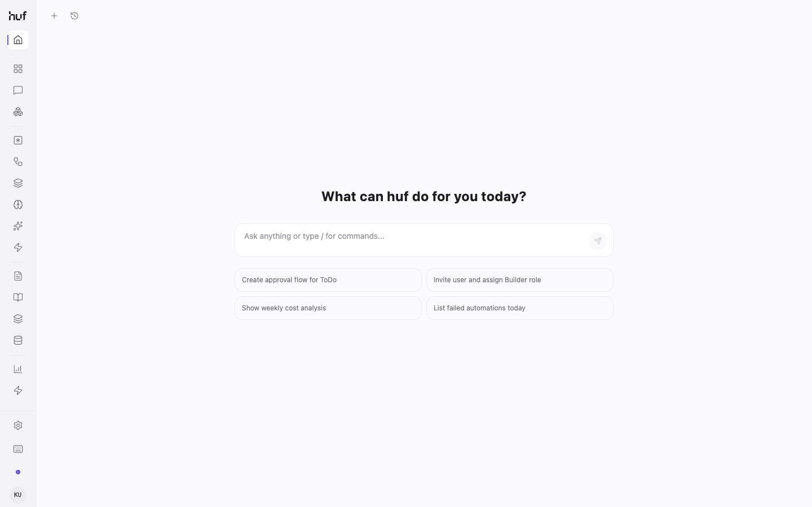
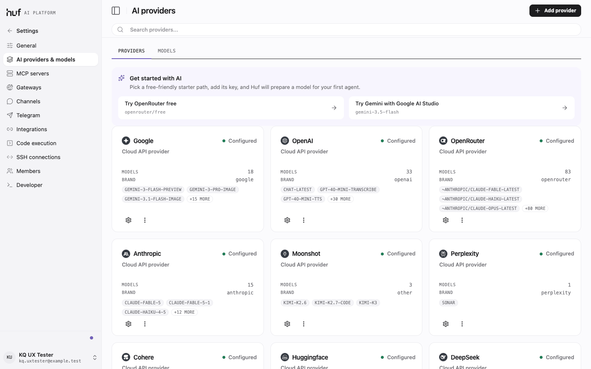

# Huf features guide

A tour of the main areas of the Huf web app. Each page says what the area is, how to use it, what you can configure and what the limits are, and links to deeper docs.

| Area | What it is | Page |
|---|---|---|
| Agents | AI agents with instructions, tools, knowledge, permissions and triggers (`/agents`) | [agents.md](agents.md) |
| Knowledge | Sources that ground agent answers in your own content (`/knowledge`) | [knowledge.md](knowledge.md) |
| Data Tables | Structured tables you create in the UI, usable by agents (`/data`) | [tables.md](tables.md) |
| Flows | Visual workflows with triggers, steps and approvals (`/flows`) | [flows.md](flows.md) |
| WhatsApp | The WhatsApp channel in Channels (`/channels/whatsapp`) | [whatsapp.md](whatsapp.md) |
| AI providers | The model providers agents run on (`/providers`, `/models`) | see below |

## AI providers

Agents and flows run on models from an AI provider. Add a provider (cloud, or a local endpoint such as Ollama or LM Studio) with its key and an optional API Base URL, then pick a model on the agent. All inference goes through LiteLLM, so any provider LiteLLM supports can be used; for one that is not in the curated list choose **Other / Custom** and enter the model as LiteLLM expects it. See the "Models & Providers" section of the [main README](../../README.md).

## Other docs

- [Main README](../../README.md): product overview and quick start.
- [Solutions](../solutions.md): several jobs on one WhatsApp number.
- [Gateways](../gateways/whatsapp-runbook.md): channel runbooks.
