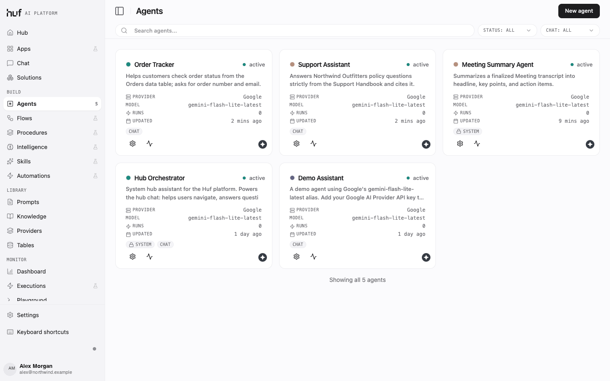
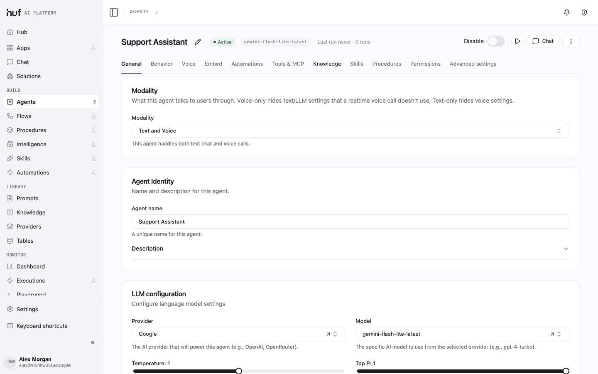
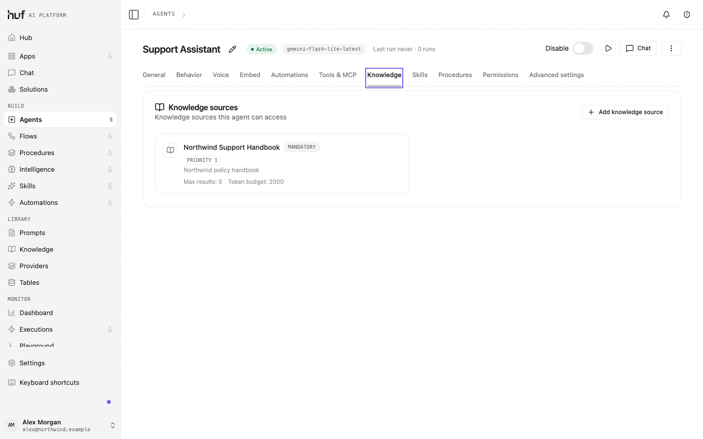
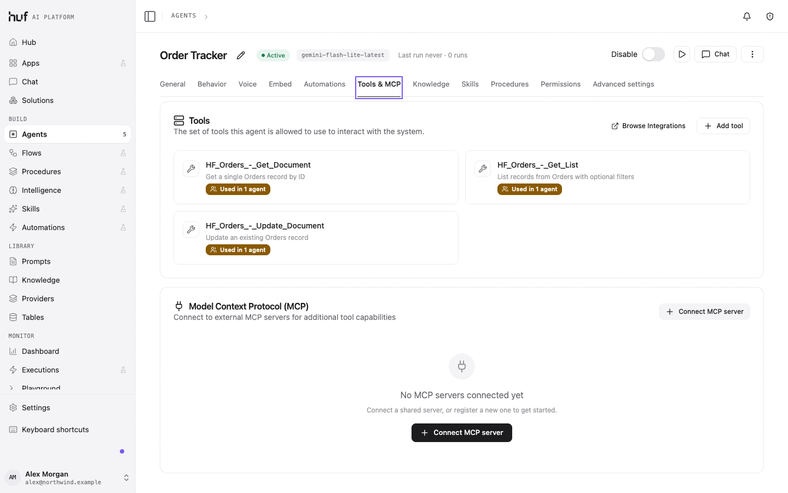

# Agents

An agent is a configured AI worker: a model, instructions, the tools it may use, the knowledge it can search, and who may talk to it. Agents live at `/agents` in the Huf app. Flows, triggers and channels (such as WhatsApp) all run agents.

## The list

The Agents page lists your agents as cards with badges for what each one has switched on (Chat, Template, Multi-run, Prompt cache, Guest). You can search, and filter by **All agents**, **Chat enabled** or **Automation only**. **New agent** (header) is shown only to people who may create agents.

## The editor

Open an agent (`/agents/:id`) to edit it. The form is split into tabs:

| Tab | What it holds |
|---|---|
| General | Name, description, provider, model and the main instructions |
| Behavior | How the agent runs |
| Voice | Voice settings (voice engine, greeting, TTS and STT models) |
| Embed | Embedding the agent on another site (publishable key, allowed origins) |
| Automations | Triggers that start the agent: document events, schedules, webhooks |
| Tools & MCP | Tools the agent may call, including MCP servers |
| Knowledge | Knowledge sources the agent can search |
| Skills | Reusable skills attached to the agent |
| Procedures | Procedures attached to the agent |
| Permissions | Who may use it (all users, guests, specific users or roles), code execution and its execution profile, SSH connections, desktop access |
| Advanced settings | Context strategy, summary model and prompts, history limit and similar |

### Knowledge tab

The Knowledge tab lists the knowledge sources attached to the agent. Add an existing source, or create a new one from there. Sources themselves are managed on the Knowledge page; see [knowledge.md](knowledge.md).

### Tools tab

The Tools & MCP tab lists the tools the agent may use. Here the Order Tracker has the View and Edit tools for the Orders data table (Get Document, Get List and Update Document), created from the table's **Agent access** setting. See [tables.md](tables.md).

## Limits and notes

- Which tabs and actions you see depends on your Huf permissions; read-only users cannot edit agents.
- Code execution, SSH and desktop access are off unless turned on in Permissions.
- The Agent form is being redesigned in beta.8. The tabs and screenshots here describe the current form and may change.

## Deeper docs

- [Main README: Agent System & Scoped Memory](../../README.md)
- [Flows](flows.md): run an agent as a step in a workflow
- [WhatsApp](whatsapp.md): connect an agent to a number
