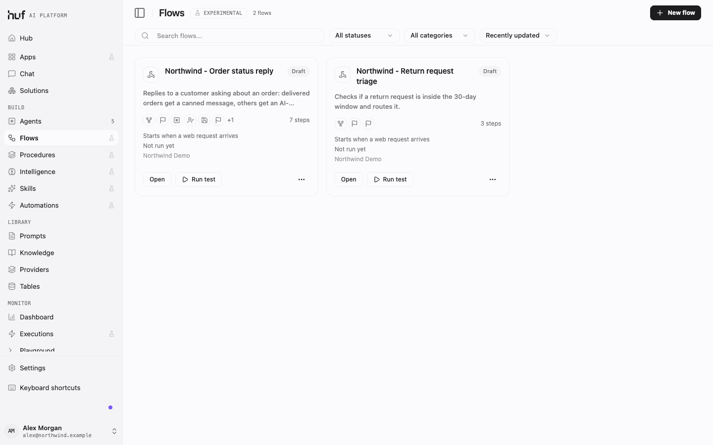
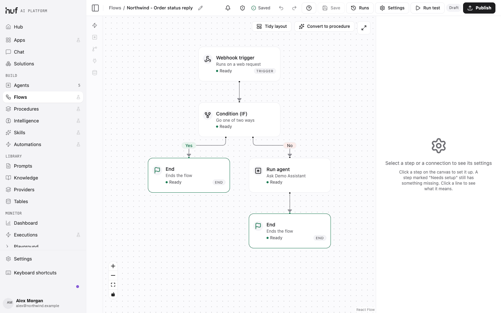

# Flows

A flow starts from a trigger and runs steps one after another, each able to use the results of the steps before it. You build it on a canvas at `/flows`: choose a trigger, add steps, connect them, then Save, Run once to test, and Publish so the trigger starts it on its own.

## The list

Each card shows the name, a description, a **Draft** or **Live** status, what starts it, how the last run went, and the steps as small icons. **Open** edits the flow, **Run** starts it by hand, and the menu has Duplicate, Settings and Delete. **New flow** offers a blank flow or a template (reply to a web request, split orders, loop over items, ask an agent, ask a person to approve, run on a schedule, post to Slack, send an email and more); a template is copied into a new draft.

## The builder

The canvas has a header with Save, Runs (history), Settings, Run (one real run with JSON input), and Publish or Unpublish. Fields have an **Insert data** button for using the trigger's data (`input`) and earlier steps' results.

**Triggers:** Webhook (secret sent in the `X-Huf-Secret` header, limited to 60 calls a minute), Schedule, When a document changes (created, changed, deleted, submitted, cancelled), and A chat message (WhatsApp, Telegram or another connected channel).

**Steps:** Run agent, Do something in an app, Web request, Send email, Slack, Google Sheets, Google Drive files, If / else, Choose with AI, Repeat for each item, Wait for approval (human-in-the-loop with Approved, Rejected and Timed out paths), Change data, Run Python code, Save/Look up/Forget saved data, Create a record, and Finish.

## Limits and notes

- A draft only runs when you press Run; a published flow is started by its trigger.
- Read-only users can view flows and runs but cannot save, run or publish.
- Publishing flows with web requests, data triggers or chat triggers needs a permission an administrator grants.
- Run Python code only appears when an administrator allows code in flows and your role may use it.
- Web requests to private networks are blocked.
- Run history times show in your browser's time zone.

## Deeper docs

- [User guide](../flow/USER_GUIDE.md): every trigger and step
- [Demo flows](../flow/DEMO_FLOWS.md): twelve flows to open and try
- [Field contract](../flow/FIELD_CONTRACT.md), [Condition](../flow/CONDITION.md), [Data input](../flow/DATA_INPUT.md)
