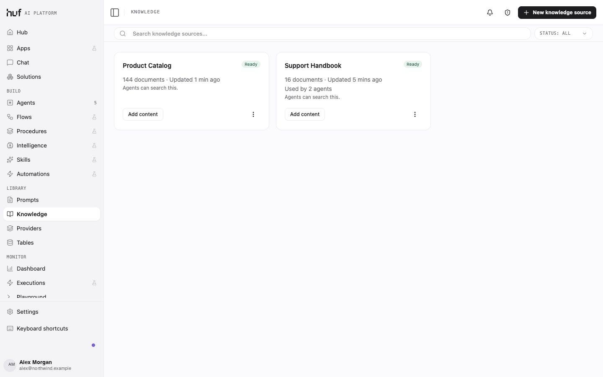
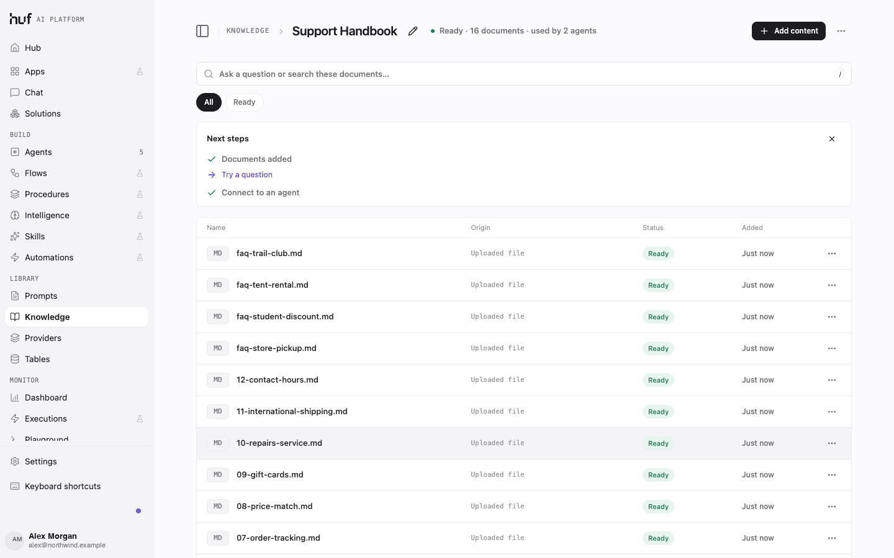
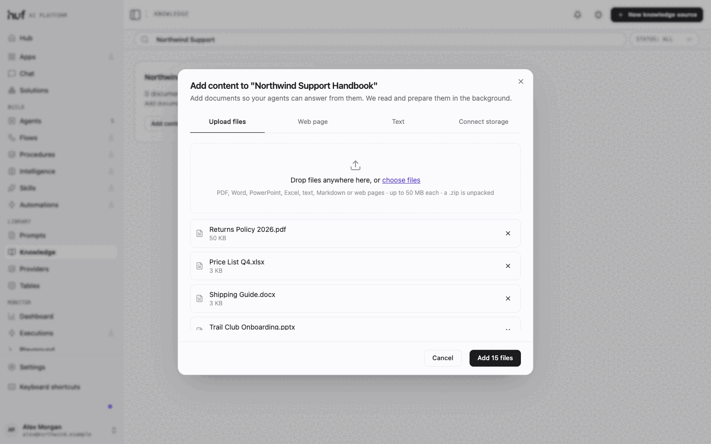
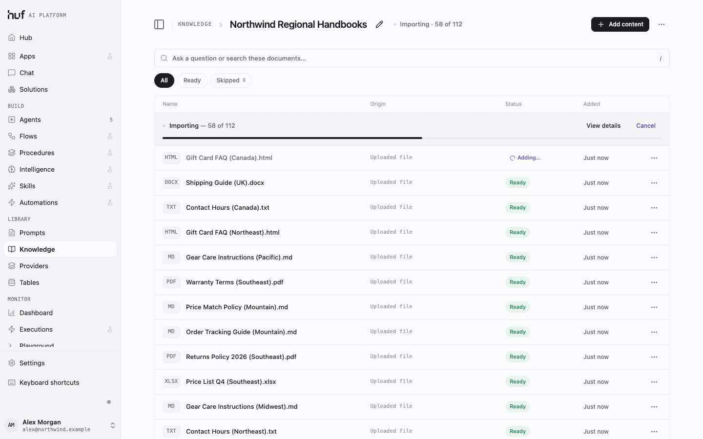
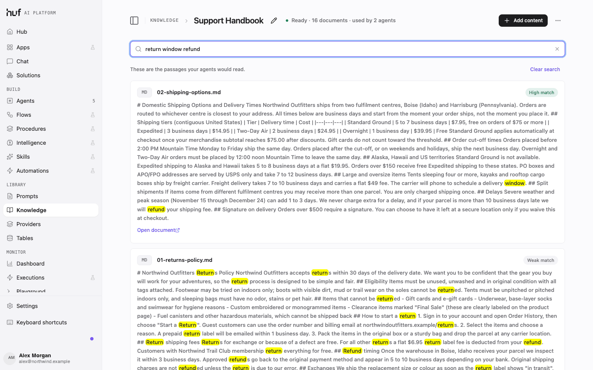
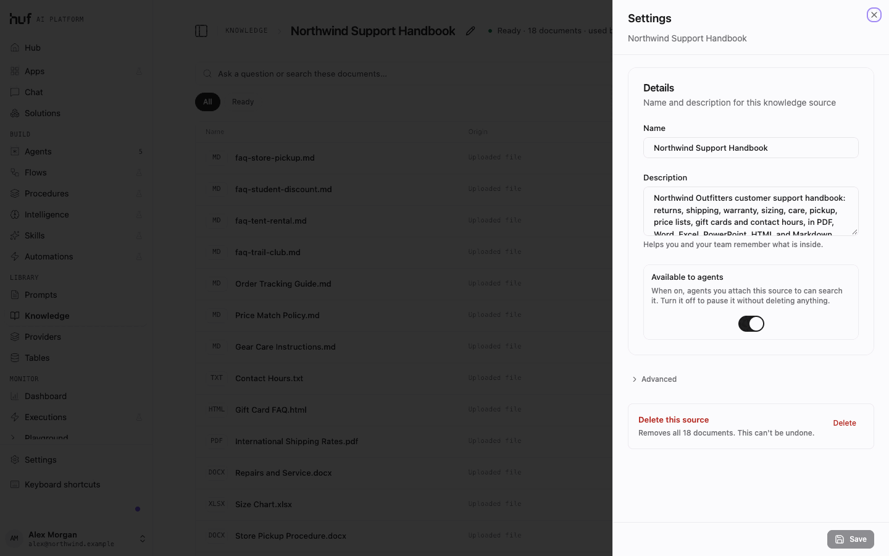

# Knowledge

Knowledge lets your agents answer from your own documents. You collect files, web pages and text into a **Knowledge Source**; Huf extracts the text, splits it into chunks, embeds them and stores them in the source's vector backend. Agents attached to the source search it at run time and cite what they found.

## Use it

1. Open **Knowledge** from the sidebar. The library lists your sources; create one (name, embedding model, backend).
2. Open a source. It is a single page with no tabs: documents, an ask box, import progress, settings and history.
3. Click **Add content** and pick a way in (below).
4. Watch the import progress, fix anything that needs attention, then ask a question to check the result.
5. Connect the source to an agent (the "Connect to an agent" step on the source page).

### Add content

The dialog offers **Upload files**, **Web page**, **Text** and **Connect storage**. Bulk file sources:

| Source | What it does |
|---|---|
| Upload | Pick or drop several files at once. |
| Zip | Upload a `.zip`; nested zips are expanded up to 3 levels deep. |
| Server folder (Directory) | Import a folder on the Huf server. System Manager only, and only under configured roots (see Configuration). |
| Amazon S3 / Cloudflare R2 | Import everything under a bucket and prefix. Works with any S3-compatible store through a custom endpoint. |
| SFTP | Import from a remote path of an enabled SSH Connection that has its host key enrolled. |

Only the kinds that are usable on your site appear: Directory needs configured roots, S3 needs active S3 settings, SFTP needs an enabled SSH Connection. Supported file types by default: `.pdf .docx .xlsx .pptx .txt .md .markdown .html .htm`.

### Live progress, retry and cancel

Each import creates a **Knowledge Ingestion** batch. It first shows **Scanning** (listing and fetching the files), then **Queued**, **Running** and a final state: Completed, Completed with Errors, Failed or Cancelled. The page polls and shows "N of M" while importing. Per-file status is Pending, Processing, Indexed, Error or Skipped.

- **Cancel** stops the batch at the next slice boundary; files already indexed stay indexed.
- **Retry failed** puts Error rows back to Pending and re-runs them. Rows are reused, never duplicated. Skipped "No Text" rows are only retried when the file still exists.
- A single failed document can also be reprocessed from the document list.
- Only one import (Scanning, Queued or Running) can be active per source at a time.
- Re-importing the same item with changed content re-indexes the same row (old chunks are replaced); unchanged content is skipped.

### Ask and citations

Use the ask field at the top of the source ("Ask a question or search these documents") to run a test search. Results show the matching chunks with match labels, highlighted snippets and the document they came from. For PDFs the citation includes the page number. Use this to confirm a source is retrievable before connecting it to an agent.

## Configuration

Set these in `site_config.json` (all optional):

| Key | Default | Meaning |
|---|---|---|
| `huf_bulk_directory_roots` | none (Directory disabled) | List of absolute paths. A Server folder import must resolve under one of them. |
| `huf_bulk_max_files` | 1000 | Maximum files per import. |
| `huf_bulk_max_file_mb` | 50 | Files larger than this are skipped as Too Large. |
| `huf_bulk_max_uncompressed_mb` | 1024 | Total uncompressed size allowed for a zip (including nested zips). |
| `huf_bulk_allowed_extensions` | see list above | Override the accepted extensions. |

**S3 / Cloudflare R2** uses an **Integration Settings** record with service `S3` and `is_active` set. Credential keys:

| Key | Required | Notes |
|---|---|---|
| `access_key_id` | yes | |
| `secret_access_key` | yes | |
| `endpoint_url` | no | Set for R2, MinIO or any S3-compatible store. Switches to path-style addressing. |
| `region` | no | Defaults to `auto` when `endpoint_url` is set, otherwise `us-east-1`. |

For R2 use `https://<account-id>.r2.cloudflarestorage.com` as the endpoint. The S3 option is also offered if the `S3_ACCESS_KEY_ID` environment variable is set.

On pgvector, embeddings of up to 2000 dimensions use a standard HNSW index; larger ones (for example 3072-dimension models) use a half-precision (`halfvec`) HNSW index, supported up to 4000 dimensions.

## Skipped reasons

A skipped file is not an error. Each carries a reason:

| Reason | Meaning |
|---|---|
| Duplicate | Same checksum as another file in the same import. |
| Unchanged | Already indexed with the same checksum. |
| No Text | Empty (zero-byte) file, or a file that produced no text or chunks. |
| Too Large | Over `huf_bulk_max_file_mb`. |
| Unsupported | Extension not in the allowed list. |
| Unsafe | A zip member that was blocked (see Safety). |

Use the **Skipped** and **Needs attention** filters on the document list to review them.

## Limits

- One source indexes one document at a time (about 3 to 10 seconds per document, so 1000 documents take roughly 1 to 3 hours). Shard very large collections across several sources.
- A Scanning import with no heartbeat for 20 minutes is failed automatically; a worker that dies mid-import is recovered by a one-minute sweeper that re-queues stalled work.
- A file is attempted at most 5 times.

## Safety

- **Zip bomb**: the declared size is pre-checked and the bytes actually written are counted against `huf_bulk_max_uncompressed_mb` (declared sizes can lie). Exceeding it aborts the import and discards the extracted files. The number of entries is also capped.
- **Zip-slip**: members with absolute paths, drive letters, `..` traversal or NUL bytes are blocked, and each target is re-checked to be inside the extraction folder.
- **Symlinks and encrypted members** in zips are blocked; folder imports never follow symlinks and skip anything whose real path leaves the root.
- Blocked members are recorded as Skipped with reason Unsafe so you can see them.
- **Unsupported, oversize and empty files** are skipped rather than extracted or failed.
- Server folder imports are admin-only and need explicit roots; with none configured the option is off.
- The ingestion record stores only non-secret config (bucket, prefix, connection name, path).

See [the bulk ingestion contract](../bulk-ingestion-contract.md) for the full API and status contract.
