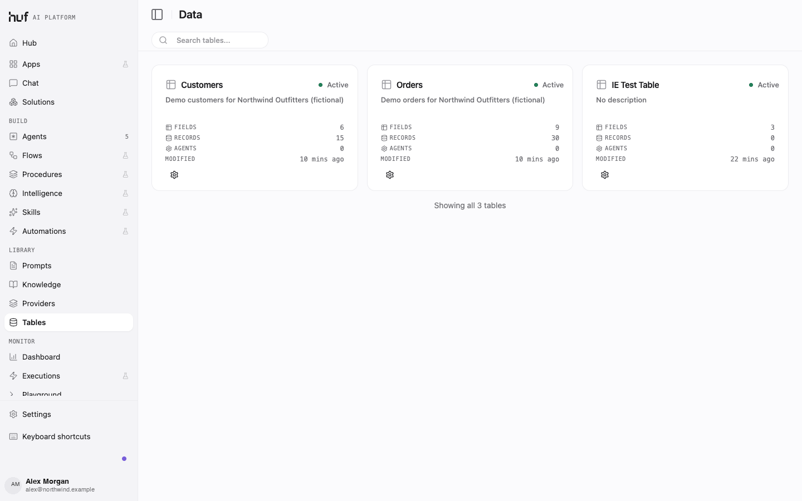
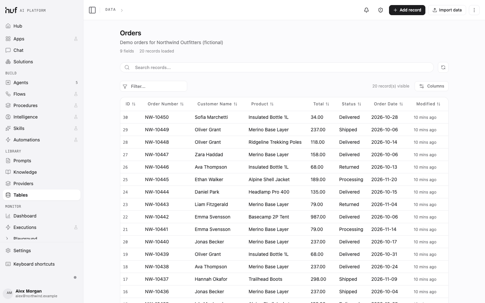

# Data Tables

Data Tables let you create structured tables from the UI, with no code and no manual schema work. Open them at `/data`. Agents can use a table as a knowledge input or through structured tools.

## The list

The list shows your tables, with description, group, icon, field count and record count. From a table you can open its records, edit its schema, delete it, and manage which agents may use it (**Agent access**). App-provided tables are shown in their own section.

## Create and edit a table

**New table** (`/data/new`) opens the table builder. Set a name, description, group and icon, a naming method (Autoincrement, Hash or By Field, with an optional title field), then add fields. Field types available: Data, Small Text, Text, Long Text, Int, Float, Currency, Percent, Check, Date, Datetime, Time, Duration, Select, Link, Rating, Color, Phone, Attach and Attach Image, plus Tab Break and Section Break for layout. Reorder fields by dragging. Editing an existing table uses the same builder (`/data/:tableId/edit`).

## Records

Open a table (`/data/:tableId`) to browse, add, edit and delete records (`/data/:tableId/:recordName` for one record). **Import data** loads a CSV file; a CSV template (optionally with the current records) can be downloaded first, and rows that fail to import are reported with their errors.

## Agent access

Per table you choose which agents may use it and what they may do: View, Create, Edit or Delete (Delete is marked destructive). Huf creates the matching tools for the agent from this setting. If no agents exist yet, create one first.

## Limits and notes

- Seeing and managing tables needs the data view/manage capabilities; import needs write permission on the table.
- Each table is backed by its own DocType record in Huf (a Huf Data Table entry holds name, group, icon, field and record counts, and an active flag).
- The Tables UI is being redesigned in beta.8; screenshots may change.

## Deeper docs

- [Bulk ingestion contract](../bulk-ingestion-contract.md)
- [Agents](agents.md) and [Knowledge](knowledge.md)
