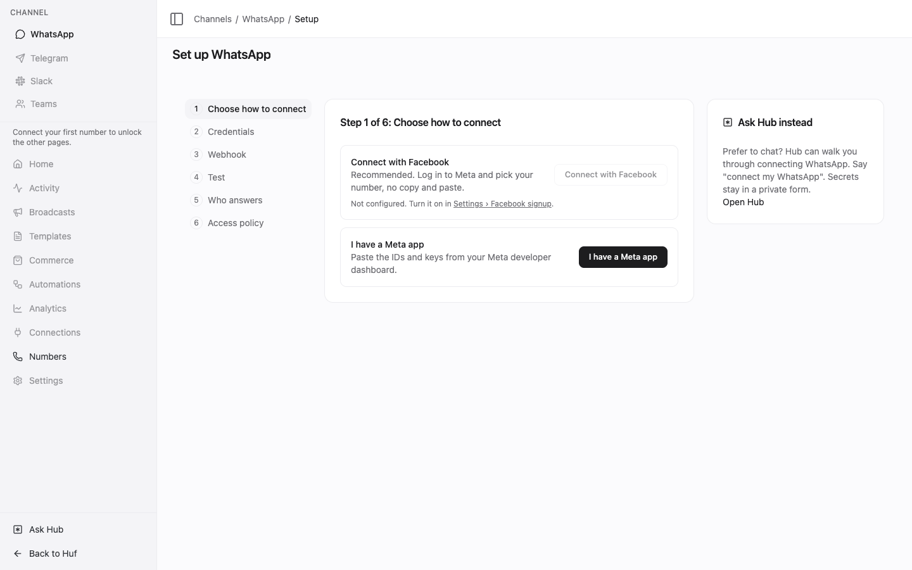
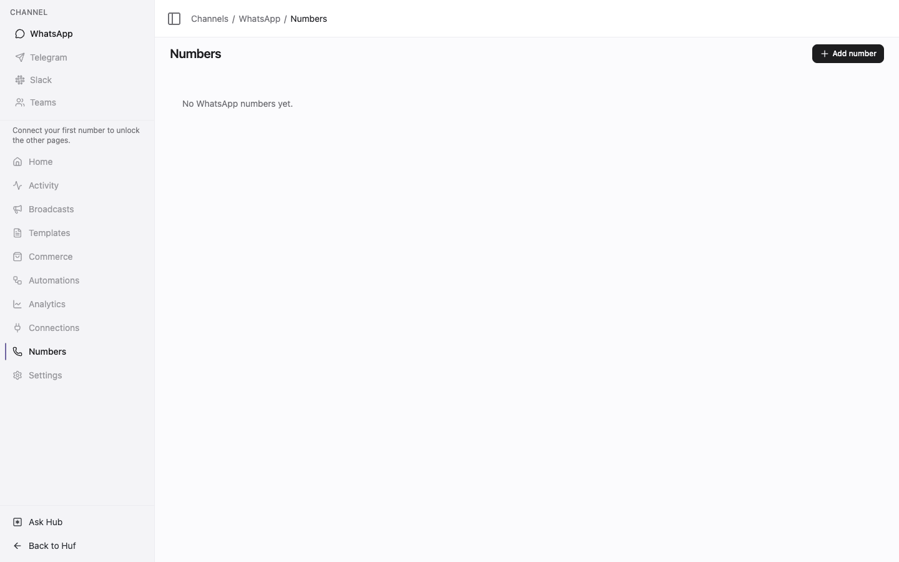
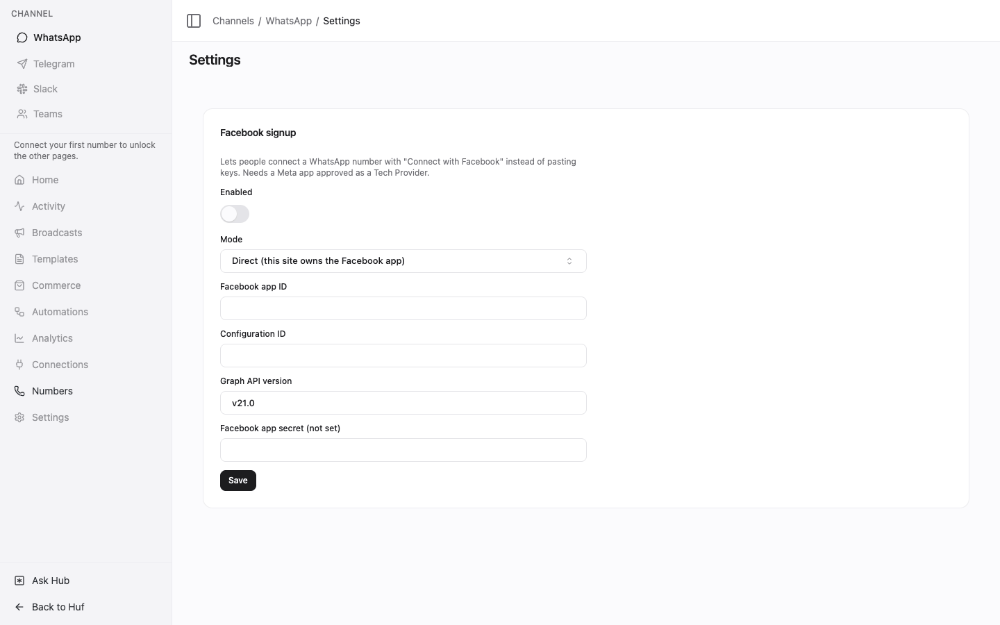

# WhatsApp

Huf connects an agent or flow to WhatsApp through the Meta WhatsApp Cloud API. You manage it in Channels (`/channels/whatsapp`).

## What you can do

- Receive customer messages and run an agent or flow on them (text, voice notes, images, documents, buttons and more).
- Reply inside the 24-hour customer window, and use approved templates outside it.
- Run several numbers on one site (one enabled gateway per phone number), and several jobs on one number with [Solutions](../solutions.md).
- Send broadcasts of one template to opted-in recipients.

## Honest note about screenshots

The screenshots below show the setup states of the app **without a connected Meta account**. They show where things are, not live conversations, templates or delivery data. Connecting a real number needs a Meta developer app and WhatsApp Business account.

## Setup

In Channels, WhatsApp, the setup page walks you through connecting a number with Meta credentials, a webhook and a token.

**Numbers** lists the connected gateways (one per number).

Once a number is chosen, the sections are Home, Activity, Broadcasts, Templates, Commerce, Automations, Analytics, Connections, Numbers and Settings. **Settings** holds the number's configuration.

## Modes

- **Direct mode** (Huf core only): Huf receives and verifies Meta webhooks and replies through the Graph API.
- **Bridge mode** (optional `frappe_whatsapp` app installed and the gateway's account set): adds template management and message history in Huf.

## Limits

- One enabled gateway per phone number.
- WhatsApp groups are not supported.
- Outside the 24-hour window a reply needs an approved template (a fallback template can be set on the gateway).
- Non-text inbound such as location, contacts and reactions is acknowledged but does not start a run (a known limitation in the runbook).
- Other documented gaps: coexistence, a human inbox, calling beyond an experimental greeting. Embedded signup ("Connect with Facebook") is described in its own doc and needs Meta Tech Provider setup.

## Deeper docs

- [WhatsApp in Huf overview](../whatsapp/README.md) and its PDF guide
- [Integration setup](../WHATSAPP_INTEGRATION_SETUP.md)
- [Operator runbook](../gateways/whatsapp-runbook.md)
- [Embedded signup](../WHATSAPP_EMBEDDED_SIGNUP.md)
- [Broadcast](../whatsapp/BROADCAST.md), [limits](../whatsapp/BROADCAST_LIMITS.md), [failover](../whatsapp/FAILOVER.md), [OTP](../whatsapp/OTP.md), [agent tools](../whatsapp/AGENT_TOOLS.md)
- [Flows](flows.md): the chat-message trigger
