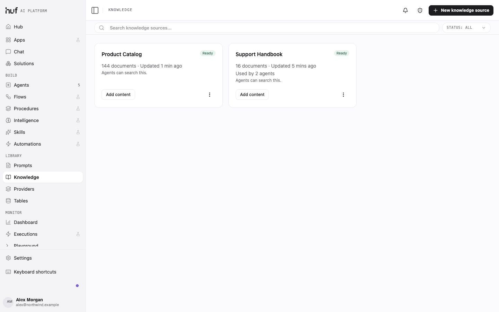
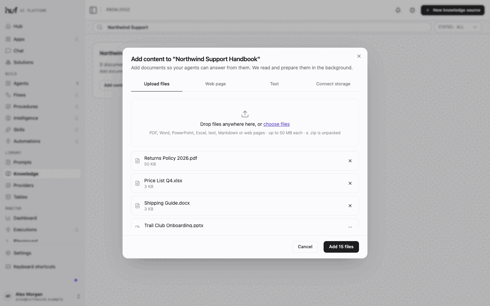
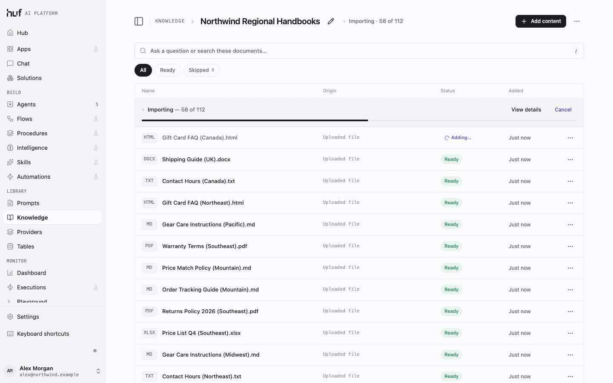
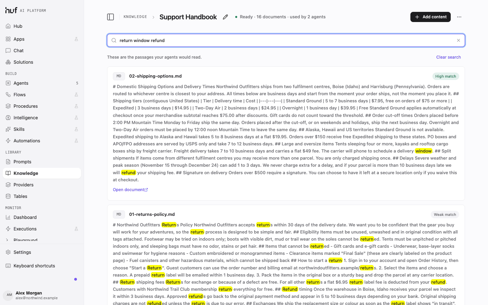
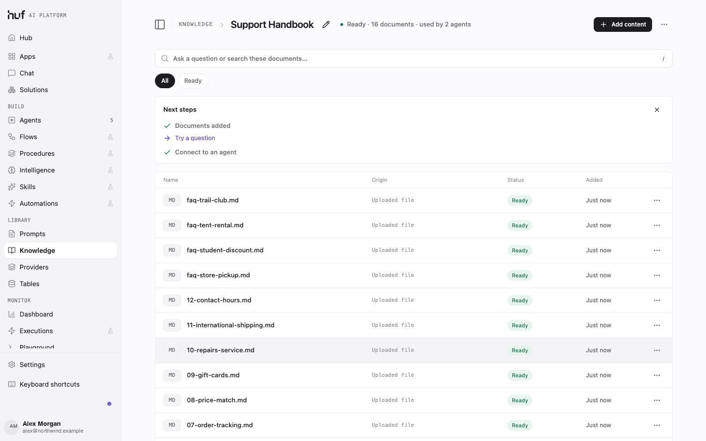
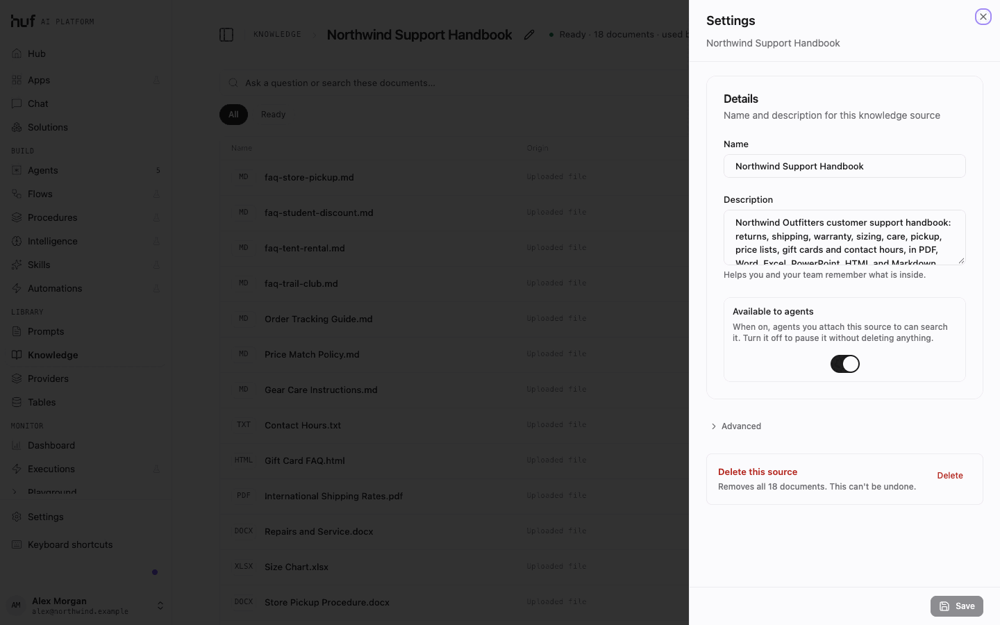

# Huf v1.0.0-beta.7

Beta 7 is about Knowledge: bring in whole collections of documents from five places, watch the import live, and trust it to survive messy real-world input.

## Highlights

### Bulk knowledge ingestion with five sources
Add content to a Knowledge Source from **Upload**, **Zip**, a **server folder**, **S3 / Cloudflare R2** or **SFTP**. Imports run as a batch (a Knowledge Ingestion) with a Scanning phase, then a queued, self-chaining runner. See [Knowledge](../features/knowledge.md).

### R2-ready S3
The S3 integration accepts an optional `endpoint_url` and `region`, so Cloudflare R2, MinIO and other S3-compatible stores work (path-style addressing, region defaults to `auto`).

### Live progress, retry and cancel
The source page shows import status as "N of M" while importing, per-file results, **Retry failed** and **Cancel**. The scanner heartbeats while Scanning and honours cancel.

### Safety
Zip bomb limits (actual bytes counted, not just declared sizes), zip-slip and symlink blocking, encrypted-member blocking, and per-file size and type limits. Blocked zip members now show up as Skipped / Unsafe instead of vanishing. Empty and unsafe files are skipped, not failed.

### PDF page citations
Chunks record the PDF page they came from, so citations in the ask panel show "page N".

### New tabless Knowledge page
The Knowledge source page is rebuilt as a single resource page (no tabs): documents, an ask field, import progress, a settings sheet and a history sheet. Inline rename saves on Enter or blur (Esc reverts). The design system gains section 6.10, Resource pages (collection views), with matching patterns and checklist; the Tables empty state now follows the same drop-zone pattern.

### pgvector HNSW for large embeddings
Embeddings with more than 2000 dimensions now get an HNSW index on pgvector (previously they could not be indexed).

## Reliability fixes from live testing

Found by running real imports against real infrastructure:

- Concurrent start: a busy source lock is now a source-level backoff, not a per-file failure; the busy clock restarts after a gap so a stale marker cannot fail a new run.
- Crashed worker: stalled ingestions and Processing rows are recovered; the Knowledge Ingestion header insert retries on a `tabSeries` deadlock.
- Empty files: zero-byte entries are skipped as No Text instead of failing.
- Stale re-import: re-importing carries the new file onto the reset row, and retry skips No Text rows that have no file.
- Failed rows can be retried per ingestion from the UI, and Reprocess shows busy state and a toast.

## CI
Server tests install pytest, and the frontend lockfile is resynced with `package.json` (ajv 8).

## Upgrade notes

1. Run `bench migrate`. New fields on Knowledge Ingestion (`source_kind`, `source_config`, status Scanning) and Knowledge Input (`ingestion`, `external_key`, `external_checksum`, `skip_reason`, `attempts`, status Skipped).
2. Optional `site_config.json` keys:
   - `huf_bulk_directory_roots`: list of absolute paths; Server folder import is off without it.
   - `huf_bulk_max_files` (default 1000)
   - `huf_bulk_max_file_mb` (default 50)
   - `huf_bulk_max_uncompressed_mb` (default 1024)
   - `huf_bulk_allowed_extensions` (default pdf, docx, xlsx, pptx, txt, md, markdown, html, htm)
3. For S3 or R2, add an active Integration Settings record for service `S3` with `access_key_id`, `secret_access_key` and optionally `endpoint_url` and `region`.

## Known issues

- The `get_signed_url` guest endpoint guard is pending a decision.
- The Tables and Agent form redesigns are coming in beta.8.
