# Huf v1.0.0-beta.8

Beta 8 redesigns Data Tables and the Agent form on the design system, and hardens both.

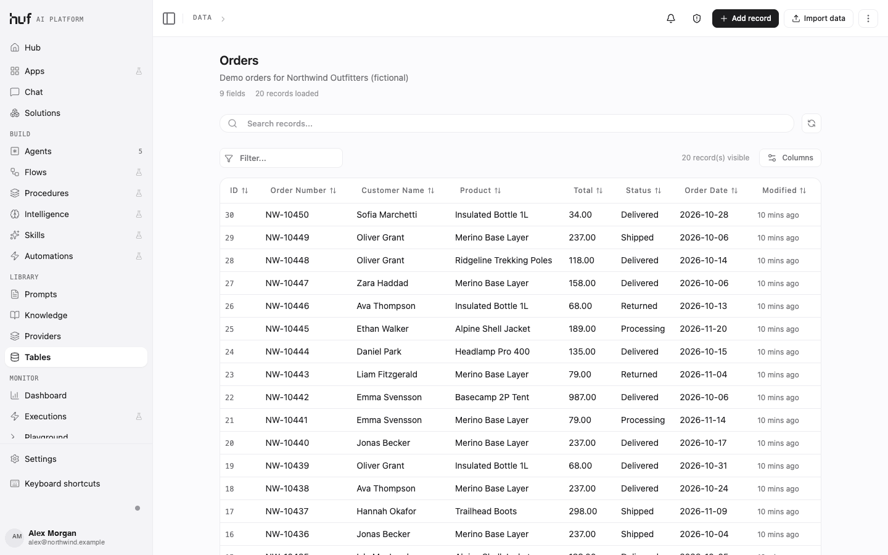

## Screenshots

<table>
<tr><td width="33%" align="center" valign="top"><a href="https://raw.githubusercontent.com/tridz-dev/huf/develop/docs/screenshots/agents/05-create.png">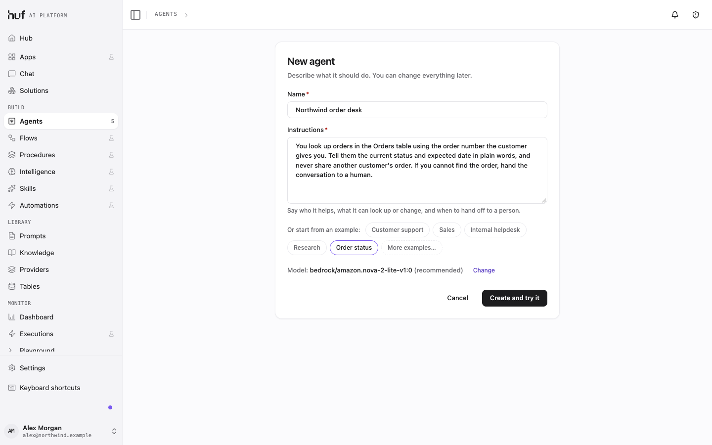</a><br/><sub><b>Create an agent from one card</b></sub></td><td width="33%" align="center" valign="top"><a href="https://raw.githubusercontent.com/tridz-dev/huf/develop/docs/screenshots/agents/06-setup.png">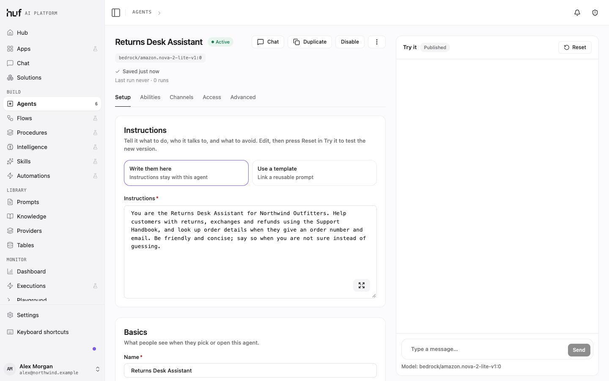</a><br/><sub><b>Setup with a live Try it panel</b></sub></td><td width="33%" align="center" valign="top"><a href="https://raw.githubusercontent.com/tridz-dev/huf/develop/docs/screenshots/agents/07-abilities.png">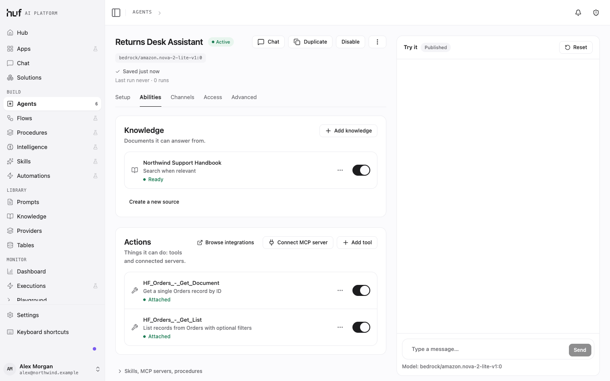</a><br/><sub><b>Abilities: knowledge and tools</b></sub></td></tr>
<tr><td width="33%" align="center" valign="top"><a href="https://raw.githubusercontent.com/tridz-dev/huf/develop/docs/screenshots/agents/08-try-it.png">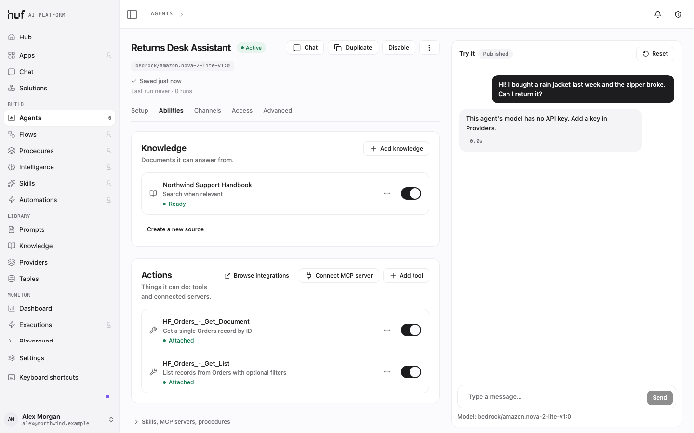</a><br/><sub><b>Try it, with friendly errors</b></sub></td><td width="33%" align="center" valign="top"><a href="https://raw.githubusercontent.com/tridz-dev/huf/develop/docs/screenshots/agents/09-access.png">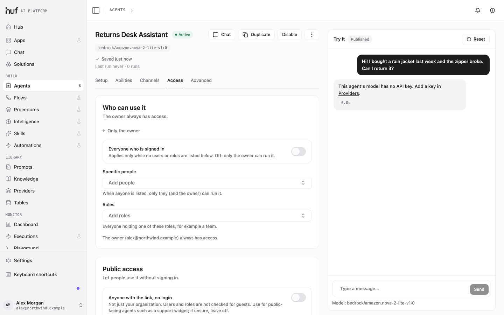</a><br/><sub><b>Access and public use</b></sub></td><td width="33%" align="center" valign="top"><a href="https://raw.githubusercontent.com/tridz-dev/huf/develop/docs/screenshots/agents/10-delete-precheck.png">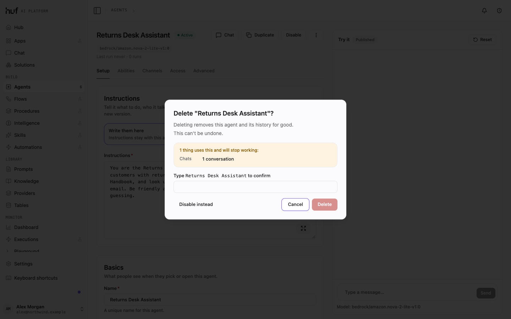</a><br/><sub><b>Delete pre-check with Disable instead</b></sub></td></tr>
<tr><td width="33%" align="center" valign="top"><a href="https://raw.githubusercontent.com/tridz-dev/huf/develop/docs/screenshots/tables/05-grid-filters.png">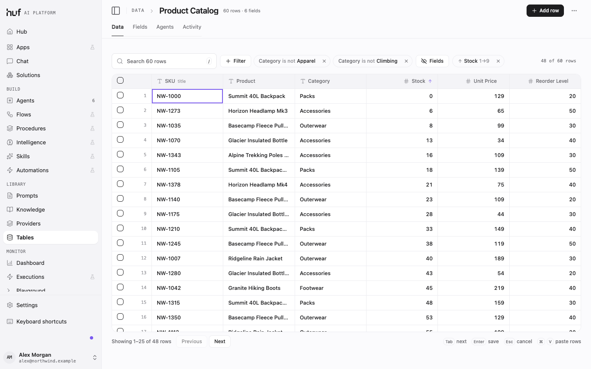</a><br/><sub><b>Grid with filter and sort chips</b></sub></td><td width="33%" align="center" valign="top"><a href="https://raw.githubusercontent.com/tridz-dev/huf/develop/docs/screenshots/tables/06-bulk-select.png">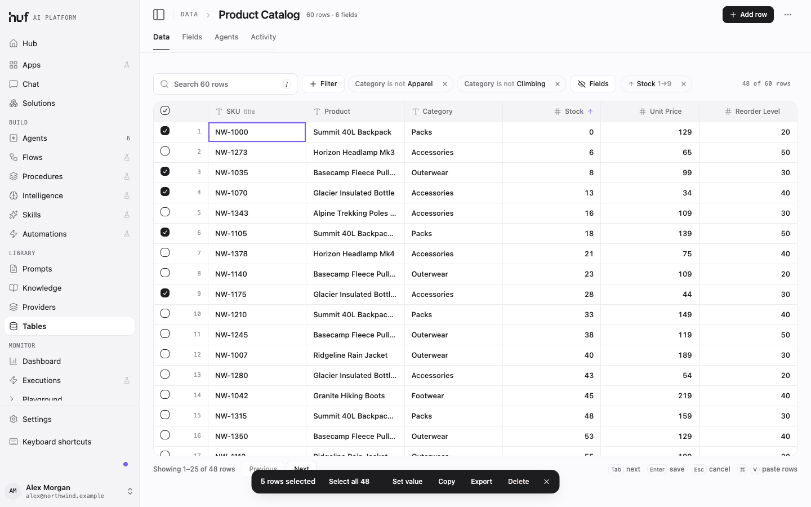</a><br/><sub><b>Bulk select, edit, export, delete</b></sub></td><td width="33%" align="center" valign="top"><a href="https://raw.githubusercontent.com/tridz-dev/huf/develop/docs/screenshots/tables/07-fields.png">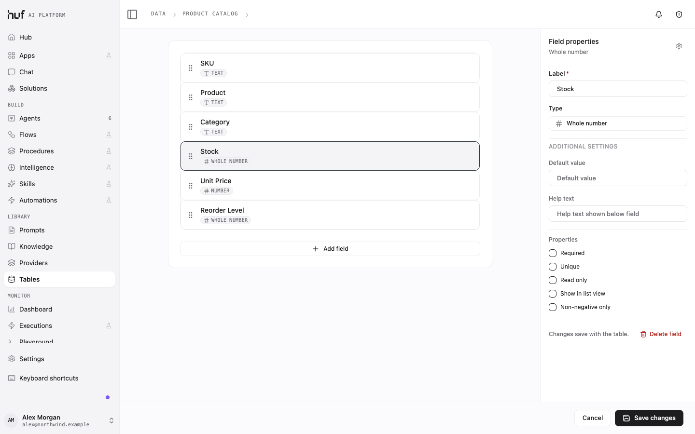</a><br/><sub><b>Field builder</b></sub></td></tr>
<tr><td width="33%" align="center" valign="top"><a href="https://raw.githubusercontent.com/tridz-dev/huf/develop/docs/screenshots/tables/08-import-mapping.png">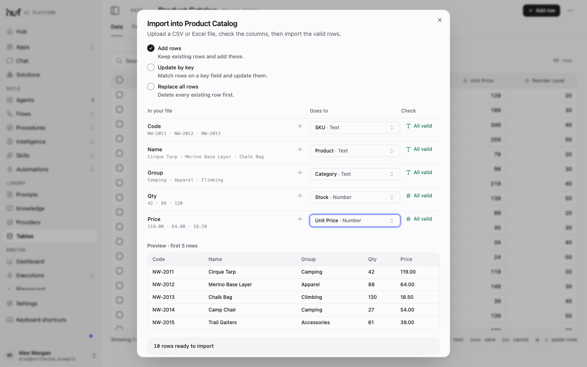</a><br/><sub><b>Import with column mapping</b></sub></td><td width="33%" align="center" valign="top"><a href="https://raw.githubusercontent.com/tridz-dev/huf/develop/docs/screenshots/tables/09-import-result.png">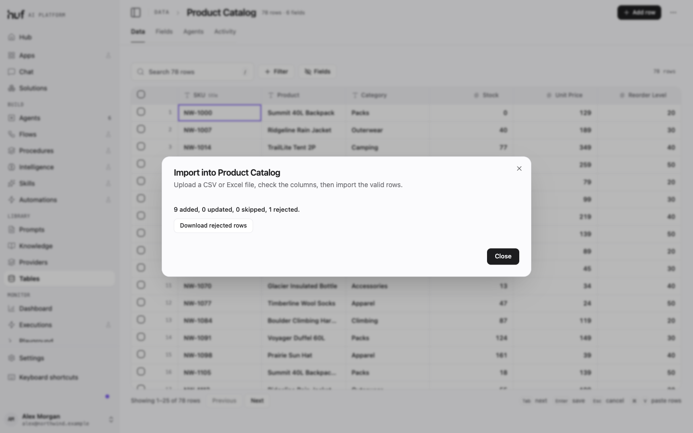</a><br/><sub><b>Import result summary</b></sub></td><td width="33%" align="center" valign="top"><a href="https://raw.githubusercontent.com/tridz-dev/huf/develop/docs/screenshots/tables/10-agent-access.png">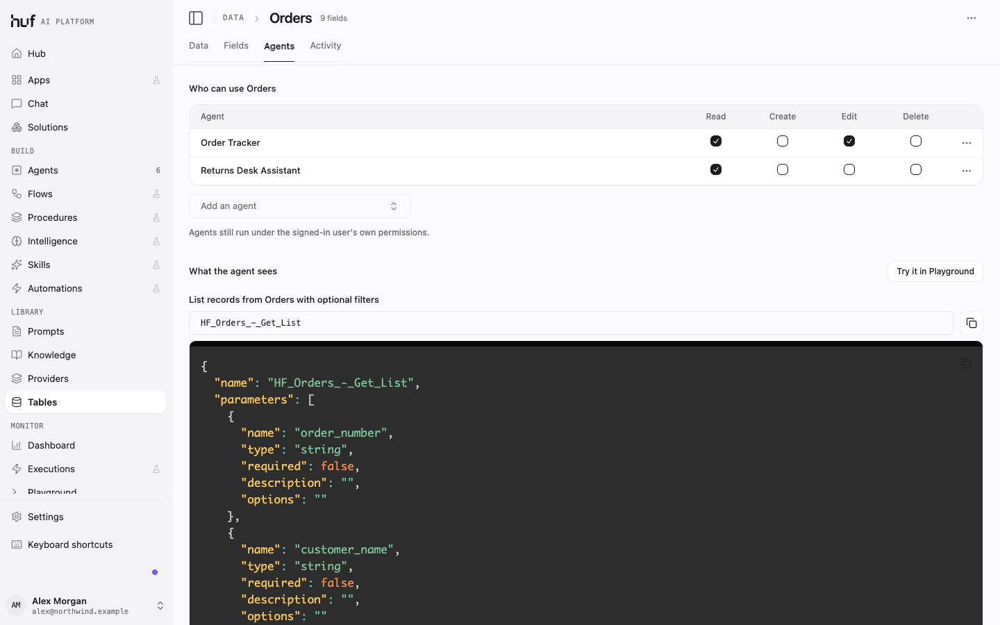</a><br/><sub><b>Agent access and what the agent sees</b></sub></td></tr>
</table>

## Highlights

### Data Tables
- **Grid:** inline editing (Tab, Enter, Esc) and paste from spreadsheets, including quoted multi-line cells.
- **Sorting and filtering:** sort and search run on the server, filters are chips, and the footer shows real totals. Rows are in stable creation order by default.
- **Bulk actions:** select rows, including Shift-click ranges, to bulk edit or delete, with **Undo**.
- **Fields:** a field builder with typed fields. Renaming a field keeps its data.
- **Import:** column mapping with a preview, in Add, Update by key or Replace mode. Replace is all-or-nothing. The result summary lists added, updated, skipped and rejected rows, and keys that matched no row are reported as "key not found".
- **Export:** formula-safe CSV export. Cells starting with `=`, `+`, `-` or `@` are escaped.
- **Agent access:** set Read, Create, Edit and Delete per agent. "What the agent sees" shows only the tools you granted.
- **Delete:** the confirm dialog lists dependents, such as rows and agents with access.

### Agent form
- **Create:** one card, with starting points like "Customer support".
- **Five tabs:** Setup, Abilities, Channels, Access and Advanced. Changes autosave.
- **Try it:** test the draft in place. Test runs leave no conversations behind and don't count as runs. If the model has no API key, it says so and links to Providers.
- **Conflicts:** if someone else edits the same agent, you choose **Keep mine** or **Use theirs** straight away.
- **Validation:** Save checks the form first and puts the cursor on the first field that needs fixing.
- **Delete:** shows a pre-check of the agent's chats and runs, and offers **Disable instead**.
- **Defaults:** new agents start on the Balanced preset.

### Design system
- Reusable data-grid patterns (DESIGN.md §6.11) and builder-form patterns (§6.12), used by Tables and the Agent form.
- The grid's range anchor and its paste parsing follow RFC 4180.

### Security
- Table import and restore only read File records the user can access.
- Bulk operations have limits and permission checks.
- Agent Try it requires write access to the agent and cleans up its own runs.

## Upgrade

```bash
bench --site <site> migrate
```

The migrate adds the `draft_test` run kind and changes the default temperature for new agents.

## Pull requests
#896, #897, #898, #901, #902, #903, #904, #905
